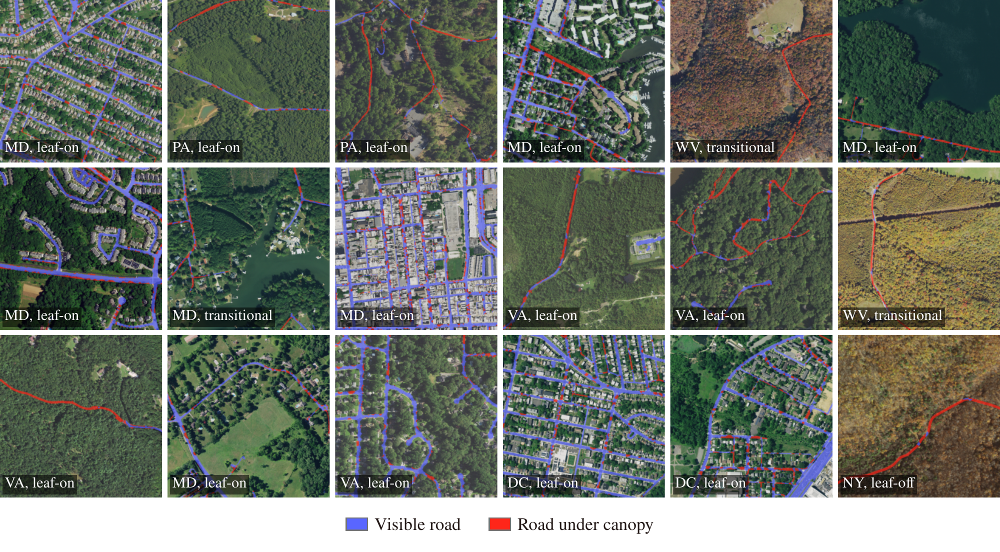
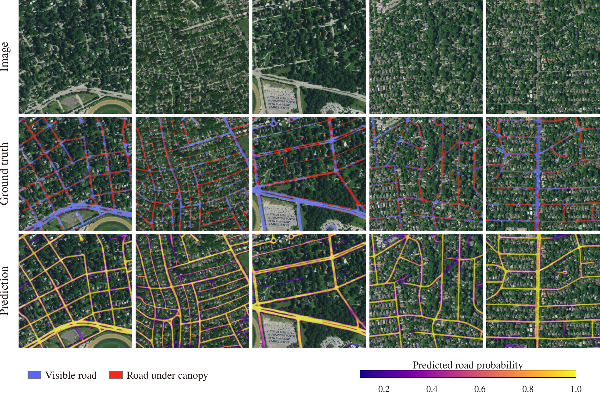

# ChesapeakeRSC v2

ChesapeakeRSC v2 provides aerial imagery, road labels, and segmentation models for roads obscured by tree canopy. It extends [ChesapeakeRSC](https://arxiv.org/abs/2401.06762) with 0.6 m NAIP imagery and separate labels for visible and canopy-covered roads.

[Dataset](https://huggingface.co/datasets/isaaccorley/chesapeakersc-v2) · [Model weights](https://huggingface.co/isaaccorley/chesapeakersc-v2)



Examples across states and seasons. Blue marks visible roads; red marks roads under tree canopy.



Image, ground truth, and predicted road probability for five examples.

## Installation

Install [uv](https://docs.astral.sh/uv/getting-started/installation/), clone the repository, and install the locked environment:

```sh
git clone https://github.com/isaaccorley/ChesapeakeRSCv2.git
cd ChesapeakeRSCv2
uv sync --locked
```

Requires Python 3.12 or 3.13. The default environment includes training, evaluation, and development tools.

| Command | Additional dependencies |
| --- | --- |
| `uv sync --locked --group dataset` | GeoPandas, Shapely, PyProj, and Planetary Computer catalog clients |
| `uv sync --locked --group release` | Hugging Face upload tools, ONNX, and ONNX Runtime |
| `uv sync --locked --all-groups` | Everything needed to build data, export models, and run all checks |

Use `--no-dev` when development tools are not needed. The [dataset guide](dataset/README.md) covers creation from source imagery; the [release guide](release/README.md) covers packaging and export.

## Training and evaluation

Training requires a GPU and a manifest whose image and target paths point to local files. The [dataset guide](dataset/README.md#training-manifest) explains how to create that manifest for built or downloaded data.

```sh
uv run python train.py --manifest /data/chesapeakersc/index/manifest.parquet \
  --dataset core --bands rgb --model unet --backbone resnet18 \
  --experiment_name core_rgb --batch_size 16 --num_epochs 100

uv run python dwr_eval.py --manifest /data/chesapeakersc/index/manifest.parquet \
  --checkpoint /path/to/model.ckpt --dataset core --split test --bands rgb
```

Use `--bands rgbn` for four-band imagery. Pixel values are divided by 255 before inference or training. Binary training combines visible and canopy-covered roads; evaluation retains those labels to report canopy recall and distance-weighted recall. `--resume_from` loads checkpoint weights with a new optimizer and cosine schedule.

Batch jobs for Slurm are in [`scripts/`](scripts/README.md). They accept your data directory, partition, and account at submission time.

## Development

Run the checks from the repository root:

```sh
uv sync --locked --all-groups
uv run --all-groups ruff format --check .
uv run --all-groups ruff check .
uv run --all-groups ty check
uv run --all-groups pyrefly check
uv run --all-groups python -m pytest --cov
```

Use `uv run ruff format .` to format code. Ruff checks imports and common errors; ty and Pyrefly check types. The tests exercise local raster processing, package imports, and model execution without downloading imagery or weights.

## Repository

| Directory | Contents |
| --- | --- |
| [`dataset/`](dataset/README.md) | Download, sampling, extraction, quality control, and split scripts |
| [`src/chesapeakersc/`](src/chesapeakersc/) | Dataset loader, augmentations, and segmentation task |
| [`release/`](release/README.md) | Export, archive, upload, and Hugging Face metadata |
| [`scripts/`](scripts/README.md) | Slurm training and evaluation jobs |
| [`tests/`](tests/) | Pipeline and command-line tests |
